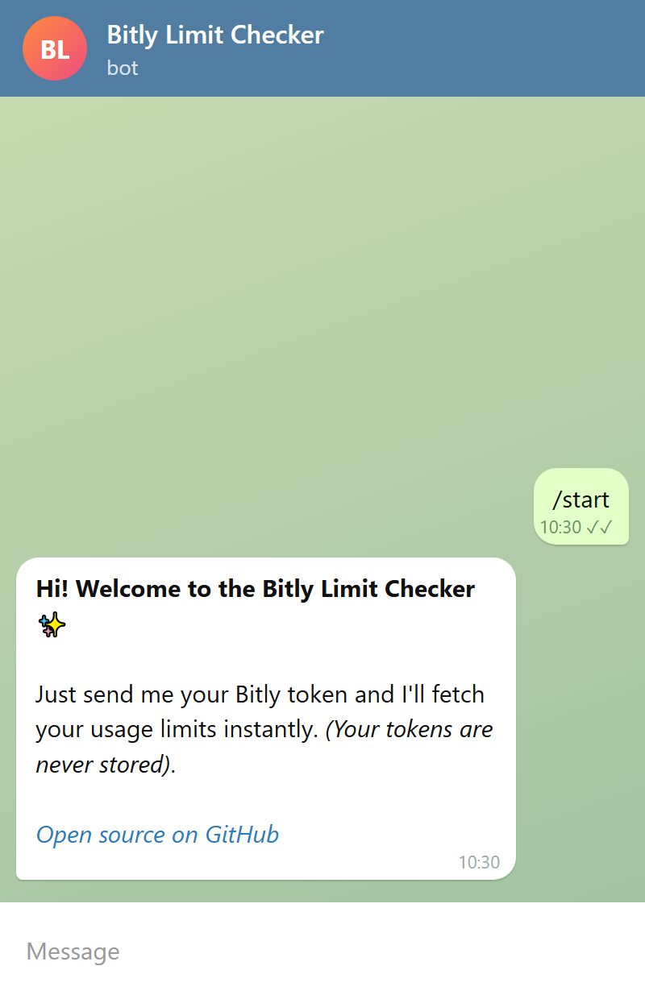
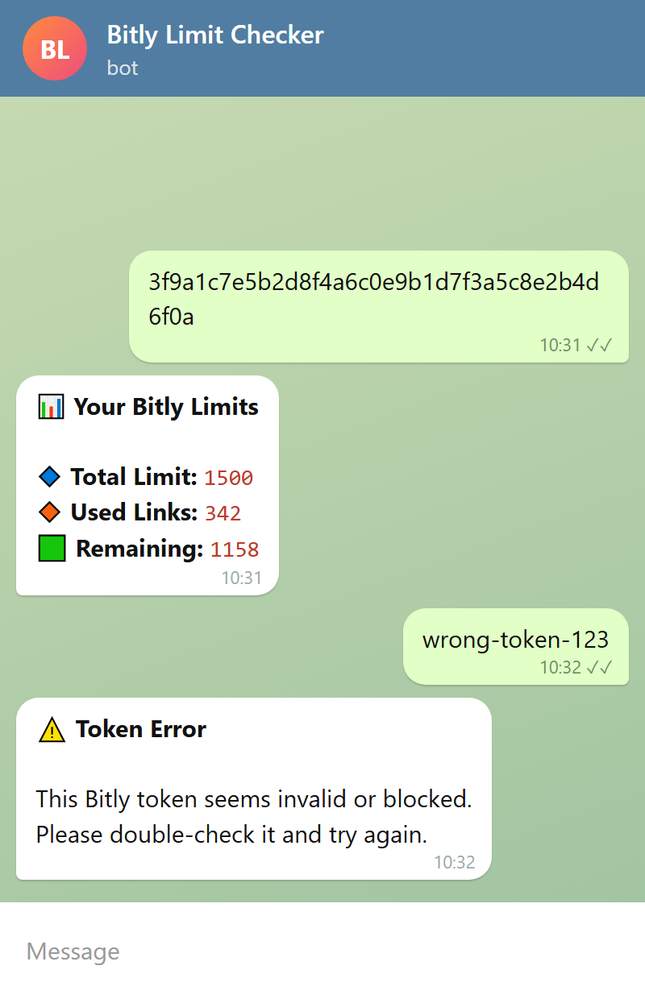
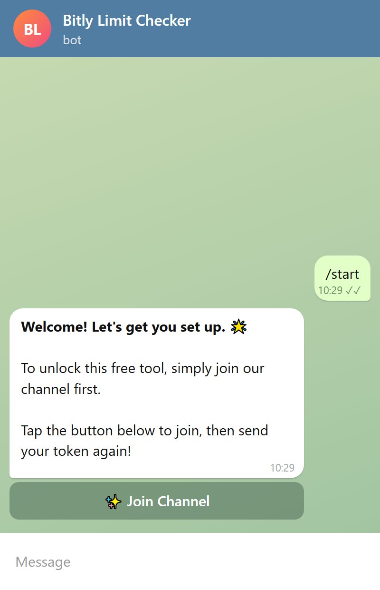

<div align="center">

# Bitly Limit Checker Bot

**Check your Bitly link limit in seconds — right inside Telegram.**

[](https://t.me/bitlylimitcheck_bot)

[](https://deploy.workers.cloudflare.com/?url=https://github.com/Affiliaters/bitly_limit_checker_telegram_bot)

[](LICENSE)
[](https://github.com/Affiliaters/bitly_limit_checker_telegram_bot/stargazers)
[](https://affiliaters.in)

[**🤖 Use the bot**](https://t.me/bitlylimitcheck_bot) · [**🚀 Deploy your own**](#-one-click-deploy) · [**🌐 Affiliaters.in**](https://affiliaters.in) · [**📚 Docs**](https://docs.affiliaters.in/) · [**🐛 Report a bug**](https://github.com/Affiliaters/bitly_limit_checker_telegram_bot/issues)

</div>

---

A free Telegram bot that tells you how many Bitly links you have used and how many are left on your plan. It runs on Cloudflare Workers (free plan).

> **Unofficial.** This project is not affiliated with, endorsed by, or sponsored by Bitly. "Bitly" is a trademark of its owner.

## 📱 Preview

<p align="center">
  
  
  
</p>
<p align="center"><sub>Welcome message · Limit check &amp; error · Optional "join channel" prompt</sub></p>

## 🤖 Use it now — no setup
1. Open **[@bitlylimitcheck_bot](https://t.me/bitlylimitcheck_bot)** in Telegram.
2. Tap **Start**.
3. Send your Bitly token ([how to get one](#where-to-get-a-bitly-token)).

Send your Bitly token to the bot and it replies with:

- 🔹 Total limit
- 🔸 Used links
- 🟩 Remaining links

## 🔒 Privacy & Terms

**Our official bot — [@bitlylimitcheck_bot](https://t.me/bitlylimitcheck_bot)**
- Does **not** save, log or share your Bitly token.
- Sends your token only to Bitly's official API (`api-ssl.bitly.com`) to read your limits, then forgets it.
- Runs exactly the code in this repository.

**Bots made by others from this repository**
- This project is open source, so anyone can copy it, **change the code**, and run their own bot.
- A modified bot **can save, log, misuse or share your token** or do anything else its owner programs it to do.
- We (the maintainers) have **no control over and take no responsibility for** bots run by other people.
- Only send your token to bots you trust. If you're unsure, generate a new token in Bitly after checking.

**Good to know**
- A Bitly token gives full access to your Bitly account. Treat it like a password.
- Your message stays in your own Telegram chat history until you delete it.
- This software is provided "as is", without warranty of any kind (see [LICENSE](LICENSE)).

## ℹ️ How the bot behaves
- Works in private chats only; it ignores groups and channels.
- Each user can send up to 10 messages per minute.

---

## ⚡ One-click deploy

[](https://deploy.workers.cloudflare.com/?url=https://github.com/Affiliaters/bitly_limit_checker_telegram_bot)

### Before you click
Open [@BotFather](https://t.me/BotFather) in Telegram, send `/newbot` and copy the **bot token**.

### After you click
1. Log in to Cloudflare and connect your GitHub account when asked.
2. Fill in the settings (type `none` for any optional one you don't want):

   | Setting               | Required? | What to enter                                                         |
   |-----------------------|-----------|-----------------------------------------------------------------------|
   | `BOT_TOKEN`           | ✅ Yes    | Your bot token                                                        |
   | `WEBHOOK_SECRET`      | Recommended | Any random word, e.g. `mySecret123`                                 |
   | `CHANNEL_ID`          | Optional  | Channel users must join first, e.g. `@mychannel` (add your bot as **Admin** there) |
   | `CHANNEL_LINK`        | Optional  | Join link, e.g. `https://t.me/mychannel` (`none` = built from `CHANNEL_ID`) |
   | `CHANNEL_BUTTON_TEXT` | Optional  | Join button label, e.g. `✨ Join My Channel`                          |
   | `WELCOME_EXTRA`       | Optional  | Extra text under the `/start` message (see below)                     |

3. Click **Deploy**.
4. Open this link in your browser (use your own Worker URL):
   ```
   https://your-worker.your-name.workers.dev/setup
   ```
   You should see **✅ Webhook connected!**

Send `/start` to your bot. Done ✅

To change a setting later: Worker → **Settings → Variables and Secrets**. If you change `WEBHOOK_SECRET`, open `/setup` again.

### `WELCOME_EXTRA` format
Telegram HTML (`<b>`, `<i>`, `<a href="...">`), with `\n` for a new line. Example:

```
<i>Powered by <a href="https://example.com">My Brand</a></i>
```

---

## Manual deploy (without the button)

1. Log in to [dash.cloudflare.com](https://dash.cloudflare.com/) → **Workers & Pages → Create → Create Worker** → **Deploy**.
2. Click **Edit code**, replace everything with the code from [`src/index.js`](src/index.js), and click **Deploy**.
3. Go to **Settings → Variables and Secrets** and add:

| Name             | Type   | Value                                            |
|------------------|--------|--------------------------------------------------|
| `BOT_TOKEN`      | Secret | Your bot token from BotFather                    |
| `WEBHOOK_SECRET` | Secret | Any random word, e.g. `mySecret123`              |
| `CHANNEL_ID`     | Text   | *Optional.* Channel users must join, e.g. `@mychannel` |
| `CHANNEL_LINK`   | Text   | *Optional.* Join link, e.g. `https://t.me/mychannel`  |
| `CHANNEL_BUTTON_TEXT` | Text | *Optional.* Join button label                    |
| `WELCOME_EXTRA`  | Text   | *Optional.* Extra text/links in the `/start` message  |

4. Open `https://<your-worker-url>/setup` in your browser to connect Telegram.

---

## Where to get a Bitly token
Bitly → **Settings → Developer settings → API → Generate token**.

## 🤝 Contributing
Want to add a feature or fix a bug? Contributions are welcome! See [CONTRIBUTING.md](CONTRIBUTING.md).

Ideas: more languages, checking several tokens at once, showing all Bitly plan limits, better anti-spam.

For security problems, see [SECURITY.md](SECURITY.md).

## ❤️ Made by Affiliaters
Built and maintained by [Affiliaters.in](https://affiliaters.in), an affiliate automation platform. New to affiliate marketing? Start with the [Quick Start Guide](https://docs.affiliaters.in/).

If this bot helps you, please ⭐ star the repo and keep the "Open source on GitHub" credit in your bot.

## License
[MIT](LICENSE)
